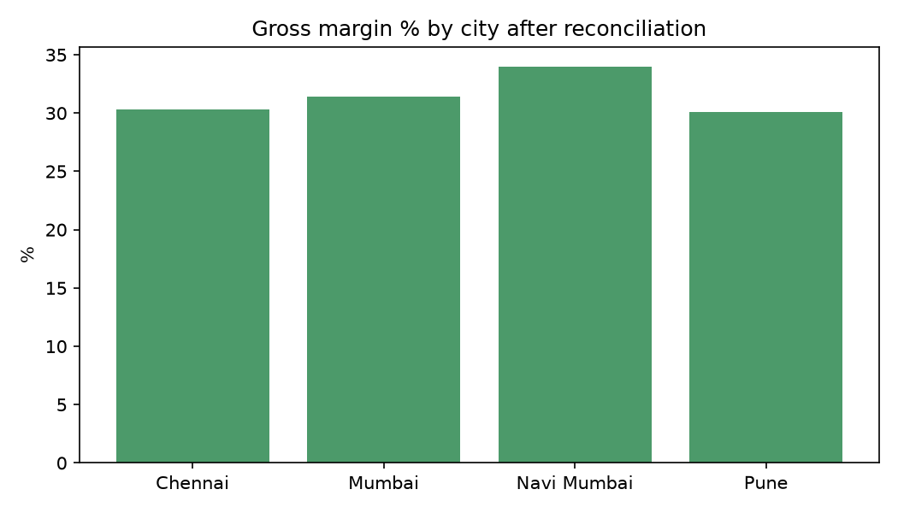

# Cab Billing Reconciliation in SQL

A SQL portfolio project based on the monthly billing work I did as a Business Analyst at a corporate employee-transport company in India: about 140 cabs on fixed office routes across 4 cities.

At work this reconciliation was done by hand in Excel, across three separate workbooks:

1. a **cab-wise KM log**: date, route, km driven, extra hours
2. a **vendor billing sheet**: what each cab vendor charged for the month
3. a **client MIS / billing calculation**: fixed monthly rate per route, plus extra-km charges

This project rebuilds that process as a small **SQLite** database and a set of **SQL** queries. The queries check the three sources against each other and produce the month-end numbers management needs.

## Interactive dashboard (Tableau Public)

[View the dashboard](https://public.tableau.com/app/profile/aniket.chavan2474/viz/CabBillingReconciliationDashboard/CabBillingReconciliationSimulatedData): KPI summary, overbilling by vendor, top 10 routes, issues by type and monthly trend, built on the same simulated dataset as the SQL queries.

> **Data note:** the data here is **simulated and anonymised**. It follows the structure, rates and distances of the real workbooks, but has no real cab numbers, people, addresses, clients or vendors. `generate_data.py` creates it from a fixed random seed, and plants known data issues so the SQL has real problems to find.

## Business questions

| # | Question | Query |
|---|----------|-------|
| 1 | How many routes, trips and km did each city run this month? | `sql/01_city_summary.sql` |
| 2 | Which routes have a different cab number in the KM log and the client MIS (replacement cabs or typos)? | `sql/02_cab_mismatch.sql` |
| 3 | Which vendors billed for more days than the cab actually ran, and by how much? | `sql/03_vendor_overbilling.sql` |
| 4 | What should each route bill the client: fixed rate plus extra km above the approved limit? | `sql/04_extra_km_billing.sql` |
| 5 | Which routes earn the lowest margin between client rate and vendor cost? | `sql/05_route_margin.sql` |
| 6 | Which daily KM entries are far above a route's normal distance? | `sql/06_km_anomalies.sql` |
| 7 | Month-end summary: client billing, vendor cost, overbilling caught and gross margin by city | `sql/07_billing_summary.sql` |

## Data model

```
routes (route_id PK, city, area, vendor, client_rate, vendor_rate,
        contract_days, approved_km_per_day, extra_km_rate)
   │ 1
   ├──< trip_log    (trip_date, route_id, cab_no, km, extra_hours)   one row per cab per working day
   ├──1 vendor_bill (route_id, cab_no, days_billed, amount)          what the vendor charged
   └──1 client_mis  (route_id, cab_no, days_billed, km_billed)       basis of the client invoice
```

## Key findings (simulated month: Feb 2025, 20 working days)

- **140 routes, 5,568 trips, ~183,000 km** across Mumbai, Navi Mumbai, Pune and Chennai.
- **28 routes (20%)** had a different cab number in the client MIS than in the KM log. These have to be fixed before the client invoice goes out.
- **7 vendor bills** charged for the full month when the cab had missed days. Rejecting those extra days removes the overbilling.
- **20 KM entries** were more than 1.5x the route's usual distance, which points to data-entry errors or over-claims to check.
- **Gross margin of 30–34% by city** after reconciliation. The lowest-margin routes (~11.5%) are where the vendor rate is highest, so they're candidates for renegotiation.

Every planted issue is found exactly by the SQL, which you can check against `data/planted_issues.csv`.



## SQL techniques used

`JOIN` / `FULL OUTER JOIN`, `GROUP BY` aggregations, CTEs (`WITH`), window functions (`RANK() OVER (PARTITION BY …)`, `ROW_NUMBER()`), conditional logic and `COALESCE`, `UNION ALL` for totals rows, and scalar `MAX()` to calculate extra km.

## How to run

Requires Python 3.9+ and matplotlib (`pip install matplotlib`). SQLite is included with Python.

```bash
python generate_data.py   # create data/*.csv (simulated, seed 2025)
python run_analysis.py    # build cab_billing.db, run sql/*.sql, write results/*.csv and charts
```

You can also open `cab_billing.db` in DB Browser for SQLite or VS Code and run any `.sql` file yourself.

## Project structure

```
cab-billing-reconciliation/
├── data/                  simulated CSVs + planted_issues.csv (answer key)
├── sql/                   00_schema.sql and 7 analysis queries
├── results/               query outputs (CSV) and charts (PNG)
├── generate_data.py       builds the simulated dataset
└── run_analysis.py        loads SQLite, runs the queries, prints findings
```

## What this shows

- Turning a manual, Excel-based reconciliation into **repeatable SQL checks**
- Business understanding of **client billing, vendor costs and margins**
- **Data-quality checks**: mismatched keys, overbilling and outliers

Author: Aniket Chavan · [linkedin.com/in/aniketchavan1519](https://linkedin.com/in/aniketchavan1519)
